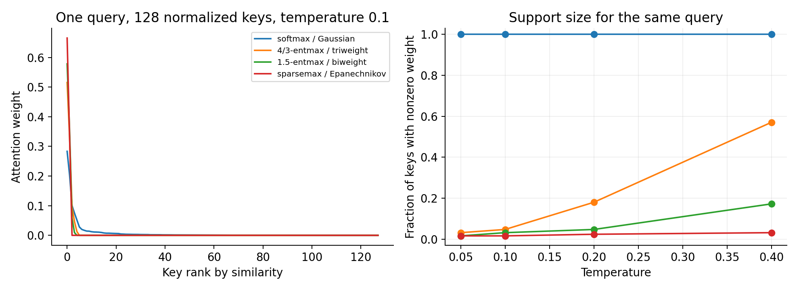
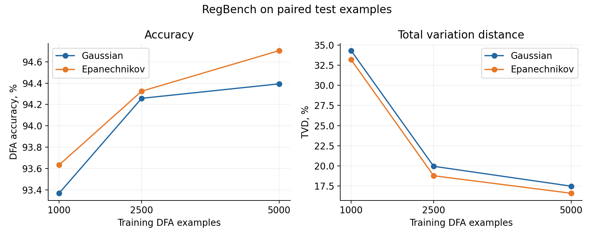
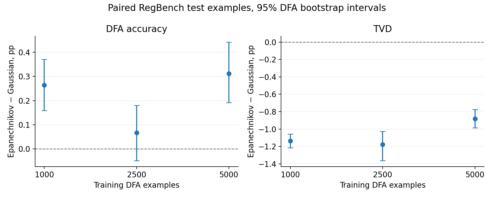
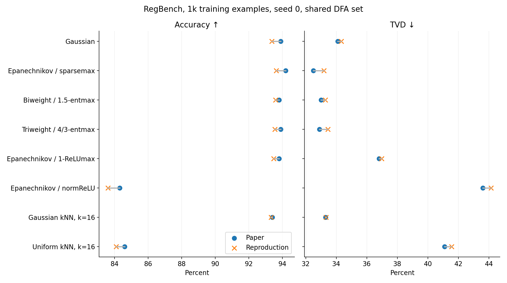
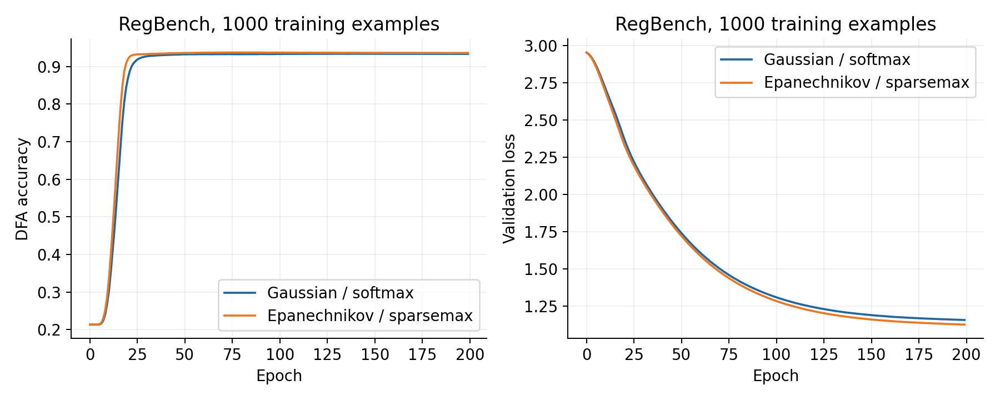
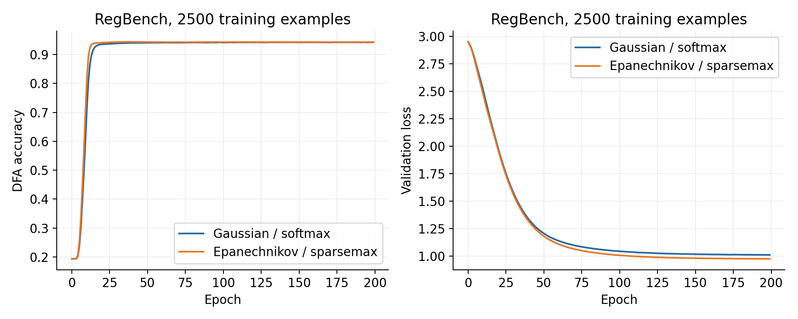
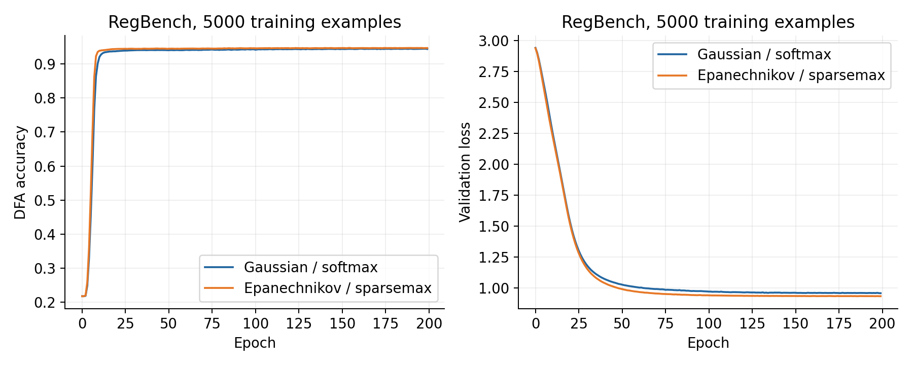

# Воспроизведение «Sparse Attention as Compact Kernel Regression»

Источник: [статья, arXiv:2601.22766](https://arxiv.org/pdf/2601.22766), [код авторов](https://github.com/deep-spin/sparse_kernel_regression). Дата проверки: 10 октября 2026 года. Джоба: `lm-mpi-job-6088ec9a-5b02-4e1f-bf20-389611e49c1c`, один узел с 8 NVIDIA H100. Все созданные файлы находятся в `/home/jovyan/yemprokopov/sparse_attention_compact_kernel_regression`.

Итоговый объём: около 6,3 ГиБ без чекпоинтов и 107 МиБ чекпоинтов. Ограничения 100 и 250 ГБ соблюдены.

## Что утверждает статья

Внимание можно рассматривать как ядерную регрессию: значения `vᵢ` усредняются с весами, зависящими от расстояния между запросом `q` и ключом `kᵢ`. Для нормированных `q` и `kᵢ` обычный `softmax(q·kᵢ/γ)` эквивалентен нормированному гауссову ядру с квадратом ширины `h² = γ`.

Статья рассматривает компактные ядра `Kₕ(u) ∝ [1 − ‖u‖²/h²]₊ʳ`. Их веса равны `α`-entmax при `α = 1 + 1/r`, если порог и ширина ядра зависят от набора ключей; в обозначениях предложения 1 ширина задаётся `h² = 2 − 2rγτ`. Частные случаи: `r=1` — Epanechnikov/`sparsemax`, `r=2` — biweight/1.5-entmax, `r=3` — triweight/4/3-entmax. В отличие от гауссова ядра, ключи за границей носителя получают точно нулевой вес. Статья также изучает фиксированный порог (`normReLU`), привязку порога к максимальному сходству (`r-ReLUmax`) и дискретный выбор `top-k`.

Главные экспериментальные заявления: компактные ядра конкурентны на BabiStories, улучшают метрики RegBench при малом числе обучающих примеров и сильнее обобщают на длинные синтетические последовательности. Таблица 2 статьи для MQMTAR при длине `32×` показывает среднюю точность 0,14 у Gaussian и 0,63 у Epanechnikov/`sparsemax`. Статья не заявляет ускорение обучения на коротком контексте как основной результат.

Выигрыш зависит от задачи. В той же таблице 2 на Reverse при длине `1,5×` Epanechnikov/`sparsemax` получает 0,03, Gaussian — 0,14, а Triweight/4/3-entmax — 0,26. Поэтому вывод о лучшем обобщении относится к выбранным ядрам и задачам, а не ко всем разреженным режимам сразу. Таблица 1 не даёт оценки разброса, поэтому небольшие различия RegBench нельзя считать статистически подтверждёнными по одному числу. Нулевые веса также сами по себе не гарантируют ускорение: оно зависит от реализации ядра и длины контекста.

## Что проверено

| Часть | Статус | Свидетельство |
|---|---|---|
| Тождество `softmax`/Gaussian и `α`-entmax/компактное ядро | Проверено численно | [результаты](theory_results.json), [график](figures/kernel_equivalence.png) |
| BabiStories: загрузка и токенизация | Проверено | [лог подготовки](logs/prepare_babistories.log), `PREPARE_EXIT_CODE=0` |
| BabiStories: прямой/обратный шаг и оценка Gaussian и Epanechnikov | Проверено на 2 шагах | [Gaussian](logs/lm_smoke_softmax.log), [Epanechnikov](logs/lm_smoke_epanechnikov_retry_ptxas.log) |
| RegBench: Gaussian и Epanechnikov на 1k, 2,5k и 5k | По 200 эпох, отдельный тест лучшего чекпоинта на одинаковых DFA внутри каждой пары | [1k](results/regbench_1000_seed0_paired_hash0.json), [2,5k](results/regbench_2500_seed0_paired_hash0.json), [5k](results/regbench_5000_seed0_paired_hash0.json) |
| RegBench: восемь методов на 1k | По 200 эпох, отдельный тест на общей выборке из 500 DFA | [метрики](results/regbench_1000_eight_methods_paired_hash0.json), [график](figures/regbench_1000_eight_methods_paired_hash0.png) |
| RegBench: парные интервалы | 10 000 повторных выборок из 500 тестовых DFA для каждого размера | [числа](results/regbench_paired_bootstrap_paired_hash0.json), [график](figures/regbench_paired_effects_paired_hash0.png) |
| BabiStories, полные кривые 80k итераций | Пока не воспроизведено | Короткая проверка не является результатом рис. 2 |
| MQMTAR, Reverse, Sort | Пока не воспроизведено | Авторы не опубликовали используемые файлы данных в репозитории |

## Численная проверка утверждения 1

Скрипт [verify_theory.py](verify_theory.py) сравнивает веса внимания и нормированные значения соответствующего ядра на 100 независимых наборах для каждого сочетания `α ∈ {1, 4/3, 1.5, 2}` и `γ ∈ {0.05, 0.1, 0.2, 0.4}`. В каждом наборе 128 случайных нормированных ключей размерности 16. Наибольшее абсолютное расхождение веса — `7,44·10⁻¹⁵`. Это проверка формулы в арифметике двойной точности, а не проверка качества обученной модели.



## Данные, код и конфигурация

- Код статьи: `upstream/`, коммит `1875650789c9cf76f2531b1ab611db3508c2f513`.
- Базовый RegBench: `seq_icl/`, коммит `9b9223d15348b5a415fb453ed988ed5f7ab9fbdc`; адаптеры из `upstream/ICLL/` перенесены локально.
- BabiStories взят из [MemoryMosaics](https://github.com/facebookresearch/MemoryMosaics), ревизия `191158129c8dab3637769988e336009a9bc5d4f2`. Контрольные суммы всех пяти частей архива проверены в [логе загрузки](logs/download_babistories_retry.log). Получено ровно 474 704 907 обучающих и 4 749 107 проверочных токенов GPT-2, как в таблице 4 статьи.
- Для RegBench: `seed=0`, 200 эпох, 2 слоя, размерность 128, 8 голов, `AdamW`, `lr=1e-4`, `weight_decay=0.01`, отбор лучшего чекпоинта по `val/loss`. Это следует команде в README авторов. Таблица 5 приложения статьи указывает `lr=5e-4`; расхождение между README и приложением влияет на точность численного сравнения.
- `dataset.num_test_examples=1000` в авторском загрузчике делится на 500 проверочных и 500 тестовых DFA. Поэтому указанные здесь итоговые метрики посчитаны по 500 тестовым примерам, а не по 1000.
- Внутри джобы используются Python 3.12.3, PyTorch 2.11.0a0+nv26.03, PyTorch Lightning 1.8.6, NumPy 1.26.4, `entmax` 1.3 и AdaSplash 0.1.1b0; [полный список ключевых версий](logs/environment_versions.log). Старый Lightning при финальном тесте не смог загрузить собственный чекпоинт из-за нового значения `weights_only` в `torch.load`. Тесты запущены отдельно с `TORCH_FORCE_NO_WEIGHTS_ONLY_LOAD=1` только для локально созданных чекпоинтов. Логи первоначального сбоя сохранены.
- Базовый адаптер `mm.py` не передавал `method` в модель, из-за чего все режимы фактически использовали бы `softmax`. Локальное исправление находится в [адаптере](seq_icl/src/models/sequence/mm.py); проверка одинаковых весов с разными режимами и различающимися выходами — [лог](logs/smoke_models_2.log).
- В авторском скрипте BabiStories отсутствовали `utils.py` и импортируемый `common_metrics_epoch1`. Файл `utils.py` скопирован из указанной выше ревизии MemoryMosaics с проверкой Git SHA; импорт изменён на существующий `common_metrics`. Для одного GPU барьер `torch.distributed` вызывается только при инициализированной группе. Эти локальные правки видны в [скрипте обучения](upstream/Library/train_memory_mosaics.py).
- Для RegBench добавлены регистрация модели и адаптер из кода статьи; импорт загрузчиков ограничен DFA, так как неиспользуемые для этой задачи загрузчики требовали отсутствующий `torchtext`. `wandb` отключён, а метрики сохранены локальным `CSVLogger` в `runs/regbench/`. Зависимости установлены в `venv/`; системное окружение не изменялось.

## RegBench: полученные метрики

Точность — доля предсказанных символов, разрешённых DFA; `TVD = (1/2N)∑ₜ‖p_model,t − p_DFA,t‖₁`. Расчёт в [analyze_regbench.py](analyze_regbench.py) следует функциям из `plot_ICL.py` авторов и агрегирует позиции последовательности. Формулировка статьи описывает точность последнего токена; это расхождение с опубликованной функцией расчёта нужно учитывать при интерпретации.

### Первые, непарные запуски

| Обучающих примеров | Ядро | Статья: Acc / TVD, % | Получено: Acc / TVD, % | Тестовых примеров |
|---:|---|---:|---:|---:|
| 1 000 | Gaussian / `softmax` | 93,9 / 34,1 | 93,54 / 33,88 | 500 |
| 1 000 | Epanechnikov / `sparsemax` | 94,2 / 32,5 | 93,89 / 32,74 | 500 |
| 2 500 | Gaussian / `softmax` | 93,7 / 20,8 | 93,95 / 20,03 | 500 |
| 2 500 | Epanechnikov / `sparsemax` | 94,0 / 19,3 | 94,39 / 19,10 | 500 |
| 5 000 | Gaussian / `softmax` | 94,6 / 17,7 | 94,58 / 17,50 | 500 |
| 5 000 | Epanechnikov / `sparsemax` | 94,4 / 17,1 | 94,52 / 16,85 | 500 |

В исходной паре 1k Epanechnikov показал точность выше на 0,35 процентного пункта и TVD ниже на 1,13 пункта по сравнению с Gaussian. Эти независимые запуски нельзя считать строгим парным сравнением: при одинаковом `seed=0` авторский загрузчик создавал разные DFA-наборы. Он переводит `set` DFA в список, а порядок зависит от `PYTHONHASHSEED`. Два отдельных создания выборок с `PYTHONHASHSEED=0` дали одинаковые SHA для val/test ([первый](results/dfa_determinism_first.json), [второй](results/dfa_determinism_second.json)). Первая оценка повторно обученной пары 1k не унаследовала этот параметр и опять создала разные наборы; её результаты сохранены с суффиксом `_pre_hashfix` и не входят в таблицу. Все значения в таблице выше получены на независимых наборах; они не доказывают статистическую устойчивость или ускорение обучения.

### Парные сравнения на общей выборке

Все 12 парных обучений достигли эпохи 199 из 200; у 10 оболочка записала `EXIT_CODE=0`. У двух запусков 1k, Gaussian и Epanechnikov, встроенный тест после обучения упал при загрузке чекпоинта из-за несовместимости старого Lightning с новым `torch.load`; их файл `EXIT_CODE` отсутствует после правки активного Bash-скрипта. **Все 12 отдельных оценок лучшего чекпоинта вернули код 0.** `PYTHONHASHSEED=0` записан в `env.txt` и `eval_env.txt` каждого запуска. Внутри каждой пары совпали SHA проверочных и тестовых выборок; у всех восьми методов 1k совпали оба SHA. [Сводный график](figures/regbench_paired_scores_paired_hash0.png).

| Обучающих DFA | Gaussian: Acc / TVD, % | Epanechnikov: Acc / TVD, % | Разница: Acc / TVD, п.п. | Тестовых DFA / позиций |
|---:|---:|---:|---:|---:|
| 1 000 | 93,369 / 34,324 | 93,633 / 33,189 | +0,265 / −1,135 | 500 / 187 848 |
| 2 500 | 94,258 / 19,940 | 94,325 / 18,763 | +0,067 / −1,177 | 500 / 188 905 |
| 5 000 | 94,394 / 17,467 | 94,705 / 16,587 | +0,312 / −0,880 | 500 / 190 654 |

Разница всегда означает Epanechnikov минус Gaussian. Отрицательная TVD лучше. Числа по каждому запуску: [1k](results/regbench_1000_seed0_paired_hash0.json), [2,5k](results/regbench_2500_seed0_paired_hash0.json), [5k](results/regbench_5000_seed0_paired_hash0.json).



Повторная выборка из 500 DFA, 10 000 повторов, дала 95% интервалы для разницы точности: 1k `[+0,159; +0,370]`, 2,5k `[−0,049; +0,180]`, 5k `[+0,191; +0,443]` п.п. Для TVD: 1k `[−1,215; −1,058]`, 2,5k `[−1,363; −1,026]`, 5k `[−0,986; −0,776]` п.п. На 2,5k интервал точности содержит ноль. Интервалы оценивают разброс по тестовым DFA при фиксированных обученных моделях; они не учитывают другие начальные веса или другие обучающие выборки. [Точные интервалы и SHA](results/regbench_paired_bootstrap_paired_hash0.json).



На 1k из таблицы 1 статьи проверены восемь методов:

| Метод | Статья: Acc / TVD, % | Получено: Acc / TVD, % |
|---|---:|---:|
| Gaussian / `softmax` | 93,9 / 34,1 | 93,369 / 34,324 |
| Epanechnikov / `sparsemax` | 94,2 / 32,5 | 93,633 / 33,189 |
| Biweight / 1.5-`entmax` | 93,8 / 33,0 | 93,597 / 33,275 |
| Triweight / 4/3-`entmax` | 93,9 / 32,9 | 93,556 / 33,443 |
| Epanechnikov / 1-`ReLUmax` | 93,8 / 36,8 | 93,484 / 36,970 |
| Epanechnikov / `normReLU` | 84,3 / 43,6 | 83,609 / 44,148 |
| Gaussian kNN, `k=16` | 93,4 / 33,3 | 93,331 / 33,321 |
| Uniform kNN, `k=16` | 84,6 / 41,1 | 84,098 / 41,556 |

Источник точных значений и проверенных SHA — [JSON](results/regbench_1000_eight_methods_paired_hash0.json). Небольшие отличия от таблицы статьи нельзя приписать одному фактору: опубликованный README задаёт `lr=1e-4`, а приложение статьи — `lr=5e-4`; способ агрегирования точности также описан неоднозначно.









Кривые первых непарных запусков: [1k](figures/regbench_1000_seed0.png), [2,5k](figures/regbench_2500_seed0.png), [5k](figures/regbench_5000_seed0.png). CSV с эпохами лежат в `runs/regbench/<имя_запуска>/metrics/version_0/metrics.csv`.

## BabiStories: границы проверки

Короткая проверка использовала реальный BabiStories, модель с одним слоем, `batch_size=1`, `bfloat16`, два шага обучения и одну оценку. `torch.compile` был выключен, чтобы отдельно проверить вычисление модели и сборку CUDA. Gaussian завершил тест с `val/loss=10,8215`; Epanechnikov — с `val/loss=10,8210`. Эти числа не сравнимы с финальными потерями из рис. 2: статья обучает 80 000 итераций с общим батчем 512, контекстом 512 и моделями с 1, 8 и 12 слоями. Первый запуск Epanechnikov выявил отсутствующий путь к `cuda.h`, следующий — к `ptxas`; оба инструмента уже были в образе и указаны в [env.sh](env.sh). Журналы неуспешных попыток сохранены.

## Невоспроизведённая часть и ограничения

Авторы пишут в [README](https://github.com/deep-spin/sparse_kernel_regression/blob/main/README.md#length-generalization), что файлы для MQMTAR, Reverse и Sort будут опубликованы позднее либо предоставляются по запросу. На 10 октября 2026 года в открытом репозитории их нет. Строго повторить таблицу 2 без этих файлов и способа генерации выборок нельзя. Данные BabiStories доступны и подготовлены, но полное обучение рис. 2 пока не выполнено. Таблица 1 статьи содержит шесть размеров выборки и больше вариантов внимания, чем проверено здесь; текущая работа воспроизводит только указанное подмножество. Сравнение RegBench использует один обучающий seed и не оценивает разброс между обучающими запусками. Ускорение на H100 не измерялось: статья в первую очередь сравнивает качество моделей, а короткие проверочные шаги не являются измерением скорости.

## Команды повторения

Все графики отчёта можно перестроить без обучения и без GPU из сохранённых результатов:

```bash
python3 scripts/build_figures.py --strict
```

Скрипт создаёт PNG и SVG в `figures/`. Для изменения оформления достаточно поправить `STYLE`, `COLORS`, `DPI` или размеры фигур в [scripts/build_figures.py](scripts/build_figures.py) и повторить команду. Он использует только JSON, CSV и NPZ, а кэш и временные файлы хранит внутри проекта. [Инструкция и список входных файлов](scripts/README.md). Финальный запуск с `--strict` завершился с кодом 0; [лог](logs/build_figures_final_plain.log).

Из корня этой папки внутри разрешённой джобы:

```bash
source env.sh
venv/bin/python verify_theory.py
PYTHONHASHSEED=0 bash launch_regbench.sh 0 softmax 1000 0 200 false paired_hash0_repeat
PYTHONHASHSEED=0 bash launch_regbench.sh 1 epanechnikov 1000 0 200 false paired_hash0_repeat
# После завершения обучения:
bash launch_eval_regbench.sh 0 softmax_1000_seed0_e200_paired_hash0_repeat
bash launch_eval_regbench.sh 1 epanechnikov_1000_seed0_e200_paired_hash0_repeat
bash run_analysis_regbench.sh 1000 paired_hash0_repeat
```

Тег `paired_hash0_repeat` защищает имеющиеся файлы от конфликта имён. Для полной матрицы аналогично задаются размеры 2 500 и 5 000, а для восьми методов на 1k — остальные значения `method` из таблицы выше. Оценки восстанавливают `PYTHONHASHSEED` из `env.txt` обучения. Для существующих результатов значения `paired_hash0` использованы в `run_analysis_variants.sh` и `run_paired_bootstrap.sh`.
